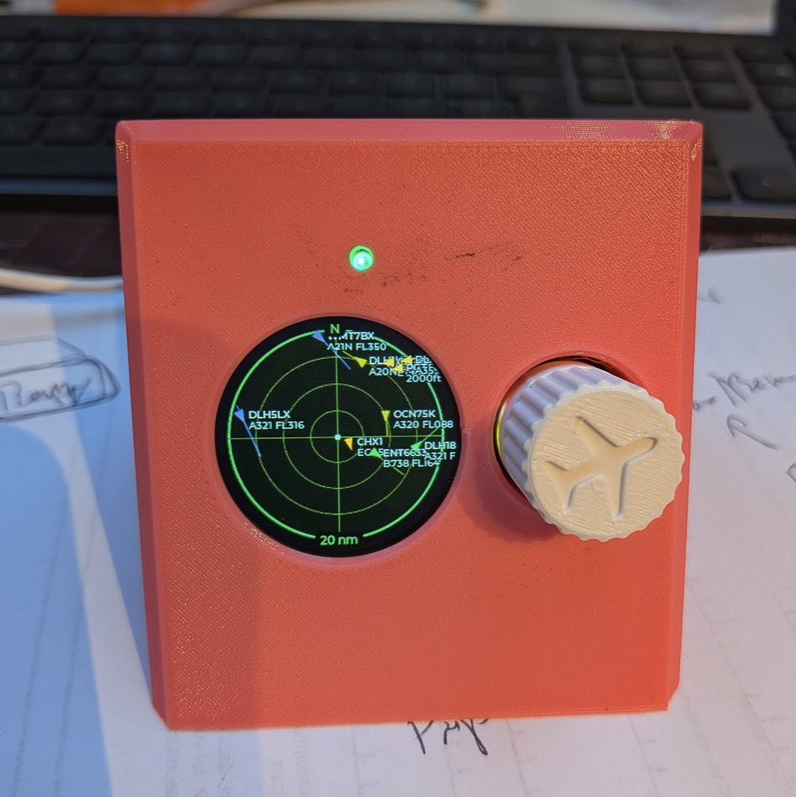

# ESP32-C3 ADS-B Radar

<p align="center">
  <a href="device.png"></a>
</p>

A small live aircraft radar for the Espressif **ESP32-C3-LCDkit** (round 240x240 GC9A01 display with a rotary encoder). It shows aircraft around a configurable location on a classic green radar scope. The knob zooms and selects aircraft. Data comes from [adsb.lol](https://api.adsb.lol/docs) or from a local **tar1090 / readsb / dump1090-fa** receiver.

## Features

- Radar scope with range rings, north-up, own position in the centre, and aircraft plotted by distance and bearing.
- Triangle aircraft symbols pointing along the track (dots when no track is known, dim for aircraft on the ground); emergency squawks (7500/7600/7700) are shown in red.
- Fading trail behind each aircraft (about the last minute) and an optional predicted track line (30 s to 2 min ahead).
- Optional colouring by altitude band, and filters to hide ground traffic or aircraft above a set altitude.
- Proximity alert: the scope flashes and shows the callsign when an aircraft comes within a set distance and below a set altitude.
- Up to four reference points (airports, landmarks) drawn on the scope.
- Dimmable backlight: brightness, dim after inactivity, and night hours (time from SNTP).
- RGB status LED: green when all is well, yellow for soft problems, red for errors that need attention, pulsing red while connecting (on, errors only, or off).
- Map background (coastlines, borders, lakes, rivers) built from Natural Earth data by the settings page; layers, brightness and colour are configurable.
- Clock screen (long press): local time and GMT in 24-hour format, date, seconds ring, and the settings address.
- Optional password for the web interface.
- 3D-printable desk case with knob (STL and OpenSCAD source).
- Firmware updates over WiFi from the settings page, with automatic rollback if a new image does not boot.
- Rotary encoder: zoom, aircraft selection, detail pages.
- Selected aircraft info card with callsign, type, altitude, speed, heading and origin/destination airports, plus a full details page with every available field.
- Optional rotating sweep (off by default to keep the UI responsive on the single-core C3).
- Runtime selectable data source: adsb.lol or a local tar1090 server.
- On-device web portal for WiFi, location, units, data source and refresh rate. A captive access point is started when no WiFi is configured.
- Settings are stored in NVS and survive reboots and re-flashing of the application.

## Hardware

| Item | Value |
| --- | --- |
| Board | ESP32-C3-LCDkit v1.1 (ESP32-C3, 4 MB flash) |
| Display | GC9A01, 240x240 round, SPI at 40 MHz, BGR, inverted |
| Encoder | EC11 quadrature encoder with push button |
| Status LED | WS2812B RGB LED |

Pin mapping (see [main/board.h](main/board.h)):

| Function | GPIO |
| --- | --- |
| LCD SCLK | 1 |
| LCD MOSI | 0 |
| LCD DC | 2 |
| LCD CS | 7 |
| LCD backlight (active high) | 5 |
| Encoder A / B | 10 / 6 |
| Encoder push button (active low) | 9 |
| RGB LED (WS2812B data) | 8 |

The display has no reset line. GPIO9 is the boot-strapping pin: do not hold the knob while resetting or the chip enters download mode.

## Case (3D printed)

A desk wedge in [case/](case/): the screen leans back 30°, the knob sits to the right of the display, and the USB cable leaves through the back. The front is closed apart from the display window, a small window for the RGB LED and the well for the knob. Footprint about 77 × 86 mm, height about 74 mm.

| File | Part | Print |
| --- | --- | --- |
| [case/lcdkit_shell.stl](case/lcdkit_shell.stl) | Wedge body with bezel, screw posts and knob well | Face down, no supports |
| [case/lcdkit_base.stl](case/lcdkit_base.stl) | Bottom plate, snaps into the shell | Flat, hooks up |
| [case/lcdkit_knob.stl](case/lcdkit_knob.stl) | Ø20 mm knob with grip flutes, D-shaft bore and an aircraft symbol on top | Standing on its bottom (bore down) |
| [case/esp32c3_lcdkit_wedge.scad](case/esp32c3_lcdkit_wedge.scad) | OpenSCAD source of all three parts | |

**Also needed**

- 4 × M2.5 × 8 mm screws (self-tapping, or machine screws cut into the plastic) to hold the board on the posts.
- A 90° up/down USB-C adapter, port bent toward the back of the board. The case is sized for a body like the Delock 65914 (about 26 × 14 × 15 mm); other sizes can be set in the SCAD file.
- A USB-C cable with a straight plug (up to about 9 mm across).

**Assembly**

1. Pull the kit's own knob cap off the encoder shaft.
2. Plug the USB-C adapter into the board.
3. Lay the board face down into the shell (USB-C toward the top) and screw it onto the four posts from the back.
4. Push the printed knob onto the shaft from the front. It sits in a well around the encoder and grips about 7.5 mm of the shaft.
5. Feed the cable through the hole in the back wall into the adapter.
6. Snap the base into the shell.

**Screen rotation:** the board is mounted rotated 90° counter-clockwise, so set **Screen rotation** on the settings page to **90° clockwise**. If the picture then shows upside down, see the troubleshooting entry for swapped 90/270 degree rotation. The knob still turns the same way (clockwise zooms in).

**Customising:** open the SCAD file in OpenSCAD and use the Customizer. `part` selects `shell`, `base`, `knob`, `assembly` (preview with a dummy board) or `fit_test`, which prints only the bezel around the display so you can check the fit in a few minutes. Useful parameters include `tilt_back`, the adapter and plug dimensions, `knob_bore` (`D` or `round` shaft) with `bore_d`, and the knob size and grip. Values marked *(assumed)* in the file, in particular `disp_top_h` (PCB to display glass) and `enc_body_h` (encoder body height), are best checked with calipers before printing. After changing parameters, export new STLs from OpenSCAD.

## Data sources

| Source | Endpoint | Notes |
| --- | --- | --- |
| adsb.lol (default) | `https://api.adsb.lol/v2/point/{lat}/{lon}/{nm}` | Internet required, radius limited to 250 nm. An API key is sent in the `X-API-Key` header (`ADSBLOL_KEY_HEADER` in `adsb.c`); it is only sent to adsb.lol. |
| tar1090 | `<base URL>/data/aircraft.json` | Local server, e.g. `http://192.168.1.20/tar1090`. Works with readsb and dump1090-fa. Plain HTTP and HTTPS supported. |
| Routes | `https://api.adsbdb.com/v0/callsign/{callsign}` | Origin and destination for the selected aircraft. Can be disabled in settings. |

The query radius follows the current zoom level (range x 1.1 + 1 nm, capped at 250 nm), so zooming out fetches a larger area. Responses are parsed as a stream and never buffered whole, so memory use stays flat. At most 48 aircraft (the nearest) are kept.

Route lookups are cached for 10 minutes; failed lookups are retried after 30 seconds.

**Rate limits:** when adsb.lol answers `429 Too Many Requests`, no further request is made until the time given by `Retry-After` (in seconds), or else by `x-ratelimit-reset`, or else after 60 s. The wait is capped at one hour, after which the radar asks again. Zooming and saving settings do not shorten the wait; changing the API key or switching to tar1090 does. Meanwhile the last aircraft stay on the scope and the top line shows a pause symbol and the time until the next request in amber, e.g. `‖ 45s` (or `12 ac ‖ 45s` with the aircraft count enabled). The settings page status line shows the same.

## Build and flash

Requirements: ESP-IDF 5.3 or newer (developed with 5.5). Managed components (LVGL 8.4, esp_lvgl_port, esp_lcd_gc9a01, mdns, led_strip) are fetched automatically on first build.

```sh
. ~/esp/esp-idf/export.sh
idf.py set-target esp32c3     # first time only
idf.py build
idf.py -p /dev/cu.usbmodemXXXX flash monitor
```

Replace the serial port with the one your board shows up as (`ls /dev/cu.usb*`). Exit the monitor with `Ctrl+]`.

After that first USB flash, later updates can be installed from the settings page (see [Firmware updates](#firmware-updates)).

If you change `sdkconfig.defaults` after a first build, delete `sdkconfig` (or run `idf.py fullclean`) so the new defaults are applied; an existing `sdkconfig` takes precedence.

## First-time setup

1. Power the board. With no stored WiFi credentials it starts an access point:
   - SSID `RADAR-SETUP`, password `radar-setup` (configurable, see below).
2. Join that network. A captive portal opens automatically; otherwise browse to `http://192.168.4.1`.
3. Enter the WiFi network and password, set the location (latitude / longitude), then save.
4. The radar restarts, joins your WiFi and starts showing aircraft.

If the saved network cannot be joined within 20 seconds, the radar falls back to the setup access point. When credentials exist the access point closes after 180 seconds and the radar retries.

## Settings page

Reach it at `http://radar.local` (mDNS) or at the IP address of the radar. The clock screen (long press in radar mode) shows the exact address.

| Setting | Description |
| --- | --- |
| WiFi SSID / password | Network to join. An empty password field keeps the stored one. |
| Latitude / longitude | Centre of the radar, decimal degrees. |
| Data source | adsb.lol or tar1090. |
| tar1090 base URL | Used for the tar1090 source, e.g. `http://192.168.1.20/tar1090`. |
| adsb.lol API key | Empty keeps the stored key; "Remove the stored key" clears it. The page only shows a shortened hint of the key, never the key itself. Defaults to `RADAR_ADSBLOL_API_KEY`. |
| Units | Aviation (nm, ft/FL, kt), metric (km, m, km/h) or imperial (mi, ft, mph). |
| Screen rotation | 0, 90, 180 or 270 degrees clockwise, for mounting the radar on its side. Applied immediately, also to the boot and setup screens. |
| Default zoom | Zoom level at start-up. |
| Refresh interval | Seconds between fetches (1-60, default 5). |
| Route lookup | Look up origin and destination of the selected aircraft. |
| Radar sweep | Draw the rotating sweep and trail. |
| Aircraft count | Show the number of visible aircraft on the top line (off by default; status messages are shown either way). |
| Aircraft labels | Any combination of callsign, aircraft type and altitude (flight level in aviation units above 6000 ft) next to each aircraft. Labels are drawn when 10 or fewer aircraft are visible and not for aircraft on the ground. Default: callsign. |
| Trails | Fading trail behind each aircraft (one point every 8 s or more, 8 points). |
| Altitude colours | Orange < 5000 ft, yellow < 10000, green < 20000, cyan < 30000, violet above. |
| Hide ground / altitude limit | Display filters; emergencies are always shown. |
| Predicted track line | Line to where the aircraft will be in 30 s, 1 min or 2 min. |
| Proximity alert | Distance and altitude of the alert zone; a faint red ring marks the radius on the scope. |
| Reference points | Up to four named markers (name up to 7 characters, latitude, longitude). |
| Status LED | On, errors only (no green), or off. |
| Map background | On/off, layers (coastlines, country borders, state/province borders, lakes, rivers), brightness and colour (green, blue, grey, amber). See [Map background](#map-background). |
| Web password | Protects the settings page and API. See below. |
| Backlight | Brightness, dimmed level (0 = off), dim after N minutes without input, night hours and time zone (POSIX TZ string, e.g. `CET-1CEST,M3.5.0,M10.5.0/3`). |

Distances and altitudes are entered in the selected units; they are stored in nm and ft.

**Web password:** when set, every page and API call needs it (HTTP Basic auth; the browser asks, any user name works). The radar stores only a salted SHA-256 hash, and each wrong attempt is answered after a one-second delay. To remove a forgotten password, hold the knob for 10 seconds on the radar. The setup access point (captive portal) does not ask for it; it is protected by its own WPA2 password. Basic auth over plain HTTP is readable by anyone who can sniff the local network, so it guards against other users of the network, not against an attacker on the wire.

Without a password, anyone on the network can change settings and install firmware. The page is served with a strict Content-Security-Policy (external connections only to `cdn.jsdelivr.net`, for the map data), and the config, firmware and map endpoints require non-form content types, which blocks simple cross-site posts.

## Controls

| Action | Radar mode | Select mode |
| --- | --- | --- |
| Rotate clockwise | Zoom in | Next aircraft |
| Rotate counter-clockwise | Zoom out | Previous aircraft |
| Short press | Enter select mode | Leave select mode |
| Long press (700 ms) | Clock screen | Toggle full details page |
| Hold 10 s | Remove the web password | Remove the web password |

On the clock screen any input returns to the radar; it also closes by itself when a proximity alert starts. Select mode ends automatically after 30 seconds without input. Rotating in select mode steps through the aircraft clockwise or counter-clockwise by bearing, starting from the nearest one.

When the display is dimmed, the first input only wakes it up. At night (inside the configured hours) the display stays bright for one minute after the last input. An active proximity alert also wakes the display.

Zoom ranges (outer ring):

| Units | Levels |
| --- | --- |
| Aviation | 5, 10, 20, 40, 80, 160 nm |
| Metric | 10, 25, 50, 100, 200, 300 km |
| Imperial | 5, 10, 25, 50, 100, 150 mi |

## Status LED

| Colour | Meaning |
| --- | --- |
| Pulsing red | Joining WiFi, rejoining after a dropout, or waiting for the first data |
| Green | Connected, data is current |
| Yellow | Soft problem that resolves itself: stale data, rate limited (429), or a failed fetch while the data is still recent |
| Red | Needs attention: setup access point active, the source rejects the request (HTTP 4xx other than 429, e.g. a bad API key or wrong tar1090 URL), or 3 failed fetches in a row with no current data |

Routine refreshes do not change the LED. In "errors only" mode green is never shown. When the display is dimmed, green is switched off and the other colours shine at a quarter brightness, so the LED stays dark at night unless something is wrong. Brightness is capped at about 15 % of the LED's maximum (`LED_MAX` in `status_led.c`).

## Display

- Green scope with four range rings and a north marker ("N" on the top of the outer ring, matching the range at the bottom); the centre dot is the configured location. The optional sweep adds a rotating line with a fading trail.
- Aircraft: green (or altitude-coloured) triangles along the track, amber with a ring for the selected aircraft (only the ring when altitude colours are on), red for emergencies, dim for aircraft on the ground. Trails and track lines use the aircraft colour.
- Aircraft labels: callsign on the first line, type and altitude in a softer green on the second (e.g. `KLM1234` over `B738 FL350`).
- Reference points: small blue-grey diamonds with their name.
- Proximity alert: the outer ring flashes red and the top line shows the callsign and distance of the nearest aircraft in the zone.
- Top line is empty while all is well (or shows the aircraft count, if enabled) and otherwise the state: `loading...`, `fetch error`, `no WiFi`, `stale` when data is old, the rate limit countdown or a proximity alert. The range of the outer ring is shown on the ring itself, at the bottom, in a small black gap.
- Select mode shows a popup card with callsign, type, registration, route, altitude, speed, track, vertical rate, distance, bearing and squawk.
- The details page adds category, hex code, barometric and GPS altitude, ground/indicated/true speed, magnetic heading, Mach, selected altitude and full origin/destination names, when the data source provides them.

## Clock screen

A long press in radar mode replaces the scope with a clock:

- local time in 24-hour format (large), with the time zone abbreviation and the date;
- GMT in military style (`13:32Z`);
- 60 ticks around the bezel, lit up to the current second;
- the settings address (`radar.local` and the IP address) at the bottom.

The time comes from `pool.ntp.org` with the time zone of the backlight settings; until it is set the clock shows `--:--`.

## Map background

The map is built in the browser, not on the radar: on the settings page, tick the layers, pick the detail and press **Build and install map**. The page downloads Natural Earth GeoJSON from jsDelivr (1:50m, about 1.5 MB, or 1:10m, about 8 MB; state borders only at 1:50m), keeps the parts within 170 nm of the saved location, simplifies them, and uploads a compact binary (typically 5 to 50 KB) to the `map` partition. It is checked (CRC and structure) before it becomes active.

On the radar the map is rasterised into a 2-bit bitmap (14 KB) whenever the zoom, location, layers or data change, and drawn tinted below the rings each frame. Coastlines and lakes are brightest, borders medium, state borders and rivers faint. The map is only shown at the location it was built for; after moving the centre, rebuild it (the settings page says so). Layers can be switched off without a rebuild; layers left out when building need one.

The data format is documented in [main/map_store.h](main/map_store.h).

## Firmware updates

1. Build with `idf.py build`.
2. Open the settings page, choose `build/radar.bin` under **Firmware** and press **Install update**.
3. The image is written to the inactive OTA slot and verified, then the radar restarts into it.

A new image must reach the main loop once after booting; if it crashes before that, the bootloader returns to the previous image on the next reset. The status line of the settings page shows the running version (`PROJECT_VER` in the top-level `CMakeLists.txt`) and slot.

**Upgrading from an earlier partition table:** the table now has two OTA slots of 1856 KB and a 256 KB map partition (see [partitions.csv](partitions.csv)). Coming from the single-app table or from the first OTA table (two 1984 KB slots, no map partition), flash once over USB with `idf.py -p PORT flash` (this writes the bootloader, partition table and app). The NVS partition keeps its offset and size, so stored settings survive.

## Configuration options

`idf.py menuconfig` -> **Radar**:

| Option | Default | Description |
| --- | --- | --- |
| `RADAR_HOSTNAME` | `radar` | mDNS name, reachable as `<name>.local` |
| `RADAR_AP_SSID` | `RADAR-SETUP` | Setup access point name |
| `RADAR_AP_PASSWORD` | `radar-setup` | Setup access point password (min. 8 characters); change it for your own build |
| `RADAR_ADSBLOL_API_KEY` | built-in key | adsb.lol API key used until one is set on the settings page (empty = no key) |
| `RADAR_ENC_STEPS_PER_DETENT` | 4 | Quadrature steps per encoder click (1-4) |
| `RADAR_ENC_REVERSE` | off | Reverse the rotation direction |
| `RADAR_LCD_MIRROR_X` | on | Mirror the display horizontally |
| `RADAR_LCD_MIRROR_Y` | off | Mirror the display vertically |

If one click jumps two zoom steps, set steps per detent to 2; if the knob feels sluggish, set it to 1.

## Project layout

| File | Purpose |
| --- | --- |
| [main/main.c](main/main.c) | Start-up sequence, input dispatch, backlight dimming, SNTP |
| [main/board.c](main/board.c) | SPI, GC9A01 panel, PWM backlight, LVGL port setup |
| [main/encoder.c](main/encoder.c) | Quadrature decoding and button handling (GPIO interrupts, debounce, long press, 10 s hold) |
| [main/config_store.c](main/config_store.c) | Settings in NVS (versioned binary blob) |
| [main/wifi_mgr.c](main/wifi_mgr.c) | Station / access point logic, network scan |
| [main/portal.c](main/portal.c) | HTTP server, captive DNS, mDNS, REST API, web password, OTA and map upload |
| [main/map_store.c](main/map_store.c) | Map data in the `map` partition: upload, validation, memory-mapped access |
| [main/web/index.html](main/web/index.html) | Settings page (embedded in the firmware) |
| [main/adsb.c](main/adsb.c) | Fetching, streaming JSON parsing, aircraft list, route lookups |
| [main/radar_ui.c](main/radar_ui.c) | LVGL scope, trails, alert, reference points, popups, details page, mode handling |
| [main/status_led.c](main/status_led.c) | WS2812B status LED (RMT via `led_strip`), pulse animation |
| [partitions.csv](partitions.csv) | Partition table: two OTA slots and the map partition |
| [case/](case/) | 3D-printable desk case (STL files and OpenSCAD source) |

Task priorities: LVGL 4, ADS-B fetch 4, button 5, main 5, captive DNS 3, status LED 2. Aircraft data is passed to the UI as snapshots under a mutex.

REST API used by the settings page: `GET/POST /api/config` (JSON), `GET /api/status`, `GET /api/scan`, `POST /api/ota` (raw image, `Content-Type: application/octet-stream`), `GET/POST/DELETE /api/map` (map info, upload as octet-stream, removal). With a web password set, all of them need it.

## Performance and memory

- Single-core RISC-V C3 without FPU: rendering is throttled to a ~80 ms tick, the scope is only redrawn when something changed (when the sweep is off), and the draw buffer is two 30-line buffers.
- Build uses size optimization (`-Os`); the image is about 1.4 MB (the 24 and 48 px clock fonts add about 140 KB), each OTA slot is 1856 KB.
- TLS requests are made one at a time from a dedicated task, so the UI stays responsive while data is fetched.
- Stored settings occupy a 488 byte NVS blob (version 9). Versions 1-3 (224 bytes), 4 (352 bytes), 5 (424 bytes) and 6-8 (432 bytes) are prefixes of the current layout and are migrated on load, with defaults for the new fields. When adding config fields, append them and add a migration in `config_store.c`.
- Trails take about 4 KB (64 slots of 8 points). The scope draw callback runs once per 30-line buffer strip, so lines outside the strip are skipped early.

## Troubleshooting

| Symptom | Check |
| --- | --- |
| Nothing on the display | Backlight is GPIO5; confirm power and that the build matches board v1.1. |
| Image mirrored | Toggle `RADAR_LCD_MIRROR_X` / `RADAR_LCD_MIRROR_Y`. |
| 90 and 270 degree rotation swapped | Swap the two entries of `ROTATION` in `radar_ui.c` (they depend on the panel's axis setup). |
| Colours wrong | The panel is BGR and inverted; byte order is controlled by `CONFIG_LV_COLOR_16_SWAP=y` in `sdkconfig.defaults`. |
| Board will not start when the knob is held | GPIO9 low at reset enters download mode; release the knob and reset. |
| Cannot reach `radar.local` | mDNS may be blocked on your network; use the IP shown on the clock screen (long press). |
| Forgot the web password | Hold the knob for 10 seconds on the radar. |
| Map not shown | Map switched on, at least one layer ticked, and built for the current location (see the settings page). "No map partition" means the new partition table has not been flashed over USB yet. |
| Map download fails | The browser needs internet access to `cdn.jsdelivr.net`; the radar itself does not download it. |
| No aircraft | Check the location, zoom level and data source. For tar1090, the URL must serve `/data/aircraft.json`. Watch the serial log for HTTP errors. |
| No route for an aircraft | Many callsigns (private, military) are not in adsbdb; lookups can also be disabled in settings. |
| Knob direction reversed | Set `RADAR_ENC_REVERSE`. |
| Firmware upload says "No OTA partition" | The board still has the old single-app partition table: flash once over USB. |
| Top line shows `‖ 45s` | adsb.lol rate limit; the radar waits as asked. Use your own API key or a longer refresh interval. |
| Night dimming does nothing | The clock comes from `pool.ntp.org`; check internet access and the time zone string. |

Serial log tag overview: `idf.py monitor` prints fetch results such as `12/57 aircraft in 44.0 nm (850 ms, heap 142000)`.

## Limitations

- Only the nearest 48 aircraft are shown.
- adsb.lol queries are limited to 250 nm; all zoom levels stay below this.
- Web password uses HTTP Basic auth over plain HTTP (no TLS on the radar).
- The map uses Natural Earth data: fine for orientation, not for navigation (1:10m has roughly a point every half kilometre).
- Between fetches, positions are extrapolated from ground speed and track (for at most 30 s).

## Data credits

- Aircraft data: [adsb.lol](https://adsb.lol) (community ADS-B network) or your own receiver via tar1090.
- Routes: [adsbdb.com](https://www.adsbdb.com).
- Map: [Natural Earth](https://www.naturalearthdata.com) (public domain), served via jsDelivr.
- UI: [LVGL](https://lvgl.io).
